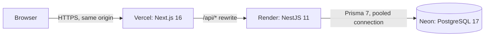

# Tanit Bank

[](https://github.com/Safwen-bm/tanit-bank/actions/workflows/ci.yml)

A full-stack retail banking platform: accounts, atomic transfers, loans with an approval workflow, debit cards, PDF statements and an admin back office. Money is handled like money: exact decimals, one transactional ledger, idempotent operations and a full audit trail.

> Portfolio project. No real money, not a licensed bank.

**Live demo: https://tanit-bank.vercel.app**

The API runs on a free tier that sleeps when idle, so the first request after a pause can take up to a minute.

## Try it

Sign in with any demo customer. The password is `Demo-Pass-2026`.

| Customer | What to look at |
|---|---|
| `amel@demo.tn` | A running loan with 3 instalments paid, a savings account, a card, six months of history |
| `youssef@demo.tn` | A loan application flagged for a high debt ratio |
| `salma@demo.tn` | A declined application with its reason, and a pending home loan |
| `karim@demo.tn` | A frozen card |

Admin credentials are available on request. You can also use the public loan simulator without an account.

## Features

**Visitor**
- Live loan products and a public loan simulator with payment schedule and balance chart. Nothing is stored.

**Customer**
- Accounts with IBANs, transfers by IBAN, simulated cash desk.
- Statement with filters, search and pagination, plus a verified PDF export.
- Loans: apply from a simulation, track the decision, repay instalments.
- Debit cards: freeze, monthly spending limit, simulated payments.
- Notifications, cash-flow chart, active loans overview.

**Admin**
- Dashboard with key figures and a ledger check that must read "balanced".
- Customers, account freeze and close, transactions explorer.
- Loan products, review queue (approve, reject, debt-ratio override) and a read-only audit log.

## Architecture



The browser only talks to the Vercel domain. Next.js forwards `/api/*` to the API, so the refresh-token cookie stays first-party (httpOnly, Secure, SameSite=Lax).

## The money rules

- **No floats.** Money is `Decimal(14,3)` (the dinar has millimes), computed with decimal.js and sent as strings.
- **One engine moves money.** Each movement is a single database transaction: lock both accounts in a fixed order, check status and funds, debit, credit, write the audit entry and the notification. All or nothing.
- **The books always balance.** An internal treasury account is the other side of every deposit, withdrawal, loan and repayment, so all balances sum to exactly zero.
- **Idempotent transfers.** The same `Idempotency-Key` sent twice moves the money once, even when both requests race.
- **Loans snapshot their conditions.** The rate is copied into the loan when the customer applies, so later changes never affect it.
- **Debt ratio includes running loans.** An application over the product's limit is flagged, and approving it needs an explicit, audited override.
- **Atomic approval.** Status, payout, repayment schedule, notification and audit entry commit together.
- **Verified statements.** Opening balance + money in - money out must equal the closing balance before a PDF is produced.

## Security

- argon2 password hashing and constant-time login.
- 15 minute access token kept in memory, rotating refresh token in an httpOnly cookie (stored only as a hash), reuse detection.
- Default-deny role guards on every route, ownership checks, deactivated users locked out immediately.
- Input validation, rate limiting, Helmet, locked-down CORS, secrets only in environment variables.
- No admin registration in the UI: the first admin comes from a seed script.

## Tech stack

| Layer | Choice |
|---|---|
| Web | Next.js 16, React 19, Tailwind CSS 4, TanStack Query, React Hook Form + Zod, Recharts |
| API | NestJS 11, TypeScript, Swagger, PDFKit |
| Database | PostgreSQL 17 on Neon, Prisma 7 |
| Auth | JWT access token + rotating refresh token, argon2 |
| Hosting | Vercel (web), Render (API), Neon (database) |

## Run it locally

You need Node 22 and a PostgreSQL database (a free Neon project works).

```bash
git clone https://github.com/Safwen-bm/tanit-bank.git
cd tanit-bank

# API
cd apps/api
cp .env.example .env        # fill in the database URLs, secrets and admin credentials
npm ci
npx prisma migrate dev
npm run db:seed             # admin, treasury account, demo loan products
npm run start:dev           # http://localhost:4000/docs

# Web (second terminal)
cd apps/web
npm ci
npm run dev                 # http://localhost:3000
```

Optional demo data (customers with six months of history):

```bash
cd apps/api
npm run build
npm run db:seed:demo
```

| Variable | Where | Purpose |
|---|---|---|
| `API_URL` | Web | API base URL, used by the `/api/*` rewrite at build time |
| `DATABASE_URL` | API | Neon pooled connection string |
| `DIRECT_URL` | API | Neon direct connection string (migrations, seeds) |
| `JWT_ACCESS_SECRET`, `JWT_REFRESH_SECRET` | API | Token signing and refresh-token hashing |
| `CORS_ORIGIN` | API | Allowed web origin |
| `TRUST_PROXY_HOPS` | API | Proxies in front of the API (2 in production) |
| `ADMIN_EMAIL`, `ADMIN_PASSWORD`, `ADMIN_NAME` | API | Read only by `npm run db:seed` |

## Deployment

| Service | Setting |
|---|---|
| Neon | PostgreSQL 17, pooled string as `DATABASE_URL`, direct string as `DIRECT_URL` |
| Render | Root `apps/api`, build `npm ci --include=dev && npm run build && npm run db:deploy`, start `npm run start`, health check `/health` |
| Vercel | Root `apps/web`, environment variable `API_URL` set before the first build |

## License

MIT