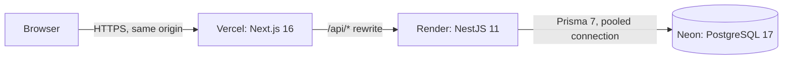
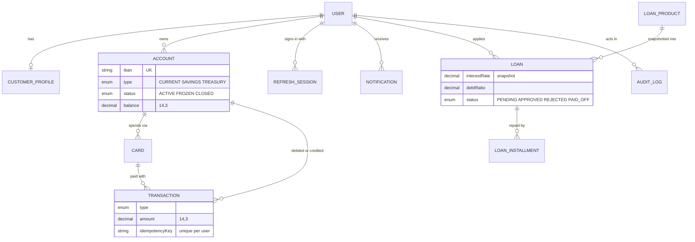
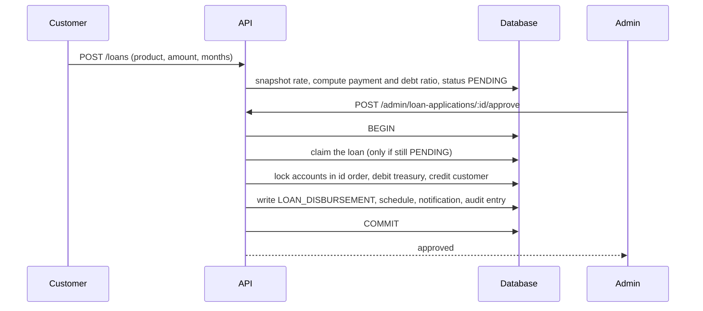

# Tanit Bank

[](https://github.com/Safwen-bm/tanit-bank/actions/workflows/ci.yml)

A full-stack retail banking platform: accounts, atomic transfers, loans with an approval workflow, debit cards, PDF statements and an admin back office. Money is handled like money: exact decimals, one transactional ledger, idempotent operations and a full audit trail.

> Portfolio project. No real money, no payment rails, not a licensed bank.

**Live demo:** https://YOUR-APP.vercel.app  |  **API docs:** https://YOUR-API.onrender.com/docs

The API runs on a free tier that sleeps when idle. The first request after a pause can take up to a minute.

| | |
|---|---|
|  |  |
|  |  |
|  |  |

## Try it

After running the demo seed (see [Run it locally](#run-it-locally)), sign in with any of these. The password is `Demo-Pass-2026`.

| Customer | What to look at |
|---|---|
| `amel@demo.tn` | A running loan with 3 instalments paid, a savings account, a card, six months of history |
| `youssef@demo.tn` | A loan application flagged for a high debt ratio |
| `salma@demo.tn` | A declined application with its reason, and a pending home loan |
| `karim@demo.tn` | A frozen card |

The admin is the account you configured in `ADMIN_EMAIL` and `ADMIN_PASSWORD`. A 3 minute walkthrough is in [docs/DEMO.md](docs/DEMO.md).

## What it does

**Visitor (no account)**
- Landing page with the bank's live loan products.
- Public loan simulator: monthly payment, total interest, full amortization table, balance chart, and the income needed to qualify. Rate limited, nothing stored.

**Customer**
- Register, sign in, rotating sessions. A first current account is opened automatically.
- Current and savings accounts with IBANs, simulated cash desk, transfers by IBAN.
- Statement with filters, search and pagination, plus a verified PDF export.
- Loans: apply from a simulation, track the decision, repay instalments.
- Debit cards: issue, freeze, monthly spending limit, simulated payments.
- Notification bell and inbox, cash-flow chart, active loans overview.

**Admin**
- Dashboard: customers, deposits, loans, 14-day activity chart, and a ledger check that must read "balanced".
- Customers: search, detail, deactivate, freeze or close accounts.
- Transactions explorer with filters and search.
- Loan products (create, edit, deactivate), review queue with approve and reject, debt-ratio override.
- Read-only audit log.

## Architecture



The browser only ever talks to the Vercel domain. Next.js forwards `/api/*` to the API, so the refresh-token cookie is first-party (httpOnly, Secure, SameSite=Lax) and there are no third-party cookie problems.

### Data model



### Approving a loan



## The money rules

1. **No floats, anywhere.** Money columns are `Decimal(14,3)` (the dinar has millimes), arithmetic uses decimal.js, and amounts travel as strings.
2. **One engine moves money.** Every movement is a single database transaction: lock both account rows in id order, re-read them, check status and funds, debit, credit, write the transaction, the audit entry and the notification. All or nothing.
3. **The books always balance.** An internal treasury account is the bank's side of every deposit, withdrawal, loan and repayment, so the sum of all balances is exactly zero. The admin dashboard checks it.
4. **Idempotent transfers.** The same `Idempotency-Key` sent twice moves the money once, even when both requests race. Reusing a key with different parameters is refused.
5. **Loans snapshot their conditions.** The product's rate is copied into the loan when the customer applies. Later admin changes never affect it.
6. **The debt ratio counts existing loans.** (new payment + payments on running loans) / declared income. An application over the product's limit is flagged, and approving it needs an explicit, audited override.
7. **The calculator lives on the server.** Payment and each month's interest are rounded to the millime, the last instalment absorbs the rounding, and combinations that cannot be scheduled are refused instead of producing a broken schedule.
8. **Approval is atomic.** Status, payout, repayment schedule, customer notification and audit entry commit together or not at all.
9. **Freezes take effect immediately.** Account and card rows are locked inside the money transaction, so a freeze or a spending limit cannot be raced.
10. **Statements are verified.** Before a PDF is produced, opening balance + money in - money out must equal the closing balance.
11. **The database refuses overdrafts too.** A check constraint rejects a negative balance on any customer account, in addition to the application check.

## Security

| Area | What is done |
|---|---|
| Passwords | argon2id, constant-time login (a dummy hash is verified for unknown emails) |
| Sessions | 15 minute access token kept in memory; rotating refresh token in an httpOnly cookie, stored only as an HMAC hash; reuse of an old token revokes every session |
| Authorization | Default-deny global guards; role checks on every route; ownership checks answer 404 so foreign resources are never revealed |
| Deactivation | Checked against the database on every request, so a deactivated user is locked out at once |
| Input | DTO validation with unknown fields rejected; money validated as strings |
| Abuse | Rate limiting on login, register, the public simulator, transfers and statements |
| Transport | Helmet on the API; security headers and `frame-ancestors 'none'` on the web app; CORS locked to the web origin |
| Secrets | Environment variables only; `.env.example` committed instead of real values |
| Admin | No admin registration in the UI: the first admin comes from a seed script |
| Cards | Only the last four digits exist; a full number is never generated or stored |
| Audit | Login, transfers, approvals, product changes, account status, card changes and statement downloads are logged; the log is read-only |

## Tech stack

| Layer | Choice |
|---|---|
| Web | Next.js 16 (App Router, `proxy.ts`), React 19, Tailwind CSS 4, TanStack Query, React Hook Form + Zod, Recharts |
| API | NestJS 11, TypeScript 5.9, Swagger, `@nestjs/throttler`, Helmet, PDFKit |
| Database | PostgreSQL 17 on Neon, Prisma 7 with the `pg` driver adapter |
| Auth | JWT access token + rotating refresh token, argon2 |
| Hosting | Vercel (web), Render (API), Neon (database) |
| Runtime | Node.js 22 LTS |

Every dependency is pinned to an exact version and the lockfiles are committed.

## Run it locally

You need Node 22 and a PostgreSQL database. A free [Neon](https://neon.tech) project works, or use the included `docker-compose.yml`.

```bash
git clone https://github.com/Safwen-bm/tanit-bank.git
cd tanit-bank

# API
cd apps/api
cp .env.example .env            # fill in the database URLs, secrets and admin credentials
npm ci
npx prisma migrate dev          # creates the tables
npm run db:seed                 # admin, treasury account, 4 demo loan products
npm run start:dev               # http://localhost:4000/docs

# Web (in a second terminal)
cd apps/web
npm ci
npm run dev                     # http://localhost:3000
```

Optional demo data (4 customers with 6 months of history, a running loan, a flagged application, a frozen card):

```bash
cd apps/api
npm run build
npm run db:seed:demo            # safe to run twice, and refuses to run with NODE_ENV=production
```

### Environment variables

| Variable | Where | Purpose |
|---|---|---|
| `API_URL` | Web (Vercel) | Base URL of the API, used by the `/api/*` rewrite at build time |
| `DATABASE_URL` | API | Neon pooled connection string |
| `DIRECT_URL` | API | Neon direct connection string, used by migrations and seeds |
| `JWT_ACCESS_SECRET`, `JWT_REFRESH_SECRET` | API | Token signing and refresh-token hashing |
| `CORS_ORIGIN` | API | Allowed web origin |
| `PORT` | API | HTTP port |
| `TRUST_PROXY_HOPS` | API | Number of proxies in front of the API (2 on Render behind Vercel) |
| `ADMIN_EMAIL`, `ADMIN_PASSWORD`, `ADMIN_NAME` | API | Read only by `npm run db:seed` |

## Deploy

1. **Neon.** Create a project (PostgreSQL 17). Keep the default branch for production and create a `dev` branch for local work. Copy the **pooled** connection string (`DATABASE_URL`) and the **direct** one (`DIRECT_URL`).
2. **Render.** New web service from this repository.
   - Root directory: `apps/api`
   - Build command: `npm ci --include=dev && npm run build && npm run db:deploy`
   - Start command: `npm run start`
   - Health check path: `/health`
   - Environment: `NODE_VERSION=22`, `NODE_ENV=production`, `DATABASE_URL`, `DIRECT_URL`, `JWT_ACCESS_SECRET`, `JWT_REFRESH_SECRET`, `CORS_ORIGIN` (your Vercel URL), `TRUST_PROXY_HOPS=2`

   The `--include=dev` matters: Render sets `NODE_ENV=production` during the build, which would otherwise skip the TypeScript compiler. A `render.yaml` blueprint with the same settings is included.
3. **Vercel.** Import the repository.
   - Root directory: `apps/web`
   - Environment: `API_URL=https://YOUR-API.onrender.com`

   `API_URL` must exist **before** the build, because the rewrite is baked in at build time.
4. **Seed the production database from your own machine** (the free Render tier has no shell). In `apps/api`:

```powershell
   $env:DATABASE_URL = "<Neon pooled URL>"
   $env:DIRECT_URL = "<Neon direct URL>"
   $env:ADMIN_EMAIL = "you@example.com"
   $env:ADMIN_PASSWORD = "a-long-password"
   npm run db:seed
   npm run build
   npm run db:seed:demo
```

5. **Check it works:** open the Vercel URL, the loan products should appear on the landing page, sign in as the admin and open the dashboard: "Ledger check: balanced".

**Cold starts.** Free Render services sleep after inactivity. Warm the API with a request to `/health` before a demo, or set the repository variable `API_HEALTH_URL` to enable the optional keep-alive workflow in `.github/workflows/keepalive.yml`. Check the current free-tier limits of Render and Neon before relying on them.

## API

Interactive documentation is served at `/docs`. The main groups:

| Group | Endpoints |
|---|---|
| Public | `GET /public/loan-products`, `POST /public/loan-simulations` |
| Auth | `POST /auth/register`, `/auth/login`, `/auth/refresh`, `/auth/logout` |
| Customer | `/accounts`, `/transactions/deposit`, `/transactions/withdraw`, `/transfers`, `/accounts/:id/transactions`, `/accounts/:id/statement` (PDF), `/loans`, `/cards`, `/notifications` |
| Admin | `/admin/stats`, `/admin/ledger-check`, `/admin/customers`, `/admin/accounts/:id/status`, `/admin/transactions`, `/admin/loan-products`, `/admin/loan-applications`, `/admin/audit-logs` |

## Project structure

```
tanit-bank/
├── apps/
│   ├── api/                 NestJS API (deployed on Render)
│   │   ├── prisma/          schema, migrations, seed
│   │   └── src/             auth, accounts, transactions (ledger), loans, cards,
│   │                        notifications, admin, audit, demo seed
│   └── web/                 Next.js app (deployed on Vercel)
│       ├── app/             (public) (customer) (admin) route groups, proxy.ts
│       └── components/ lib/
├── docs/                    demo guide, screenshots
├── .github/workflows/       CI and optional keep-alive
├── docker-compose.yml       optional local PostgreSQL
└── render.yaml              optional Render blueprint
```

## Design

The interface is deliberately not a template. It is a ledger: warm paper with ruled lines, a mosaic band taken from Carthaginian tilework, serif display type with monospaced figures that always align, and "stamp" buttons with a hard offset shadow. The logo is the sign of Tanit. Three themes (Sable, Nuit, Lagune) switch from the header.

## Known limitations

- **No automated test suite yet.** The money paths (concurrent transfers, idempotency, approvals, limits) were verified with scripted end-to-end scenarios during development, but those scenarios are not in the repository.
- Rate limiting is in memory, so it is per API instance.
- The web app sets `frame-ancestors` but no full Content-Security-Policy.
- Notifications refresh by polling every 30 seconds.
- One currency (TND) and simulated cash: no real payment rails.
- `npm audit` reports advisories in the Prisma CLI (its bundled MySQL dev server and config merger, not used with PostgreSQL) and in the YAML output of `@nestjs/swagger`. None is reachable at runtime from user input, and the available fixes are major-version changes, so they are tracked rather than applied.

## Roadmap

- [x] Stage 1: core banking platform (phases 0 to 7)
- [ ] Stage 2 (optional): AI financial assistant. A deterministic affordability service computes the numbers, and an LLM that can only call read-only tools explains them.

## License

MIT